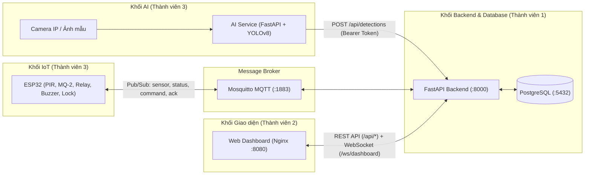
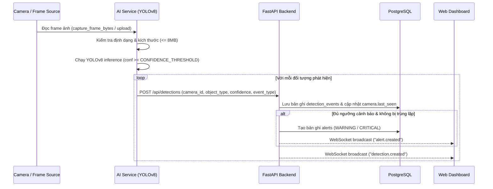

# Thiết kế Kiến trúc Hệ thống & Mô hình MVC (Tuần 2 – Tuần 3)

## 1. Sơ đồ Kiến trúc Tổng thể

Hệ thống được thiết kế theo kiến trúc phân tán gồm 3 khối chính (**AI Service**, **IoT Edge ESP32**, **Core Backend + Web Dashboard**) giao tiếp qua các giao thức chuẩn (`HTTP REST`, `WebSocket`, `MQTT`):

---

## 2. Ánh xạ Kiến trúc MVC / Layered trong Dự án

Để đảm bảo tách biệt trách nhiệm (Separation of Concerns), mã nguồn được chia thành các tầng rõ ràng:

| Thành phần MVC | Thư mục / Tệp nguồn | Trách nhiệm chính |
|---|---|---|
| **Model (Dữ liệu & Ràng buộc)** | `backend/app/models/__init__.py` `backend/app/schemas/__init__.py` `backend/app/database/base.py` `database/init.sql`, `database/seed.sql` | Định nghĩa 8 bảng ORM (`User`, `Camera`, `Device`, `Sensor`, `DetectionEvent`, `Alert`, `DeviceLog`, `SystemLog`), quản lý kết nối SQLAlchemy và kiểm tra dữ liệu đầu vào bằng Pydantic. |
| **View (Giao diện hiển thị)** | `frontend/index.html` `frontend/css/style.css` | Bố cục 10 màn hình của trung tâm giám sát SmartSecure, hệ thống thẻ thống kê, biểu đồ cột/tròn, bảng dữ liệu, modal và thiết kế đáp ứng (responsive). |
| **Controller & Service (Điều phối & Nghiệp vụ)** | `backend/app/routers/__init__.py` `backend/app/services/__init__.py` `backend/app/websocket/__init__.py` `backend/app/mqtt/__init__.py` `frontend/js/app.js`, `frontend/js/api.js` | Xử lý request HTTP, xác thực/phân quyền JWT, ẩn mật khẩu RTSP, đánh giá quy tắc tạo cảnh báo & chống trùng, đồng bộ MQTT command/ACK, phát sự kiện WebSocket và cập nhật DOM phía trình duyệt. |

---

## 3. Thiết kế Phân quyền (RBAC — Thành viên 1)

| Chức năng / Endpoint | `OPERATOR` | `ADMIN` | `AI_SERVICE_TOKEN` |
|---|:---:|:---:|:---:|
| Đăng nhập (`POST /api/auth/login`), xem hồ sơ (`GET /api/auth/me`) | Có | Có | — |
| Xem danh sách Camera, Thiết bị, Cảm biến, Cảnh báo, Thống kê, Nhật ký | Có | Có | — |
| Xử lý cảnh báo (`PUT /api/alerts/{id}/resolve`) | Có | Có | — |
| Gửi lệnh điều khiển thiết bị IoT (`POST /api/devices/{id}/command`) | Có | Có | — |
| Thêm / Sửa / Xóa Camera (`POST`, `PUT`, `DELETE /api/cameras/*`) | Không (`403`) | **Có** | — |
| Gửi sự kiện phát hiện AI (`POST /api/detections`) | Có | Có | **Có** |

---

## 4. Phương án Nhận diện AI & Luồng Xử lý Frame (Thành viên 3)

---

## 5. Ranh giới Tin cậy & Quy tắc An toàn

- Mật khẩu người dùng chỉ lưu dưới dạng băm (`bcrypt`); khóa bí mật JWT và token dịch vụ lấy từ biến môi trường (`.env`).
- Đường dẫn `rtsp_url` của camera có thể chứa `username:password@`: hàm `redact_rtsp_url()` trong `app/services` luôn loại bỏ thông tin xác thực trước khi trả JSON cho giao diện.
- Phát hiện của AI không tự ý kích hoạt còi hú hay mở khóa cửa; mọi lệnh điều khiển vật lý đều đi qua `POST /api/devices/{device_id}/command`, gắn `command_id` và chờ bản tin `ack` từ ESP32.
