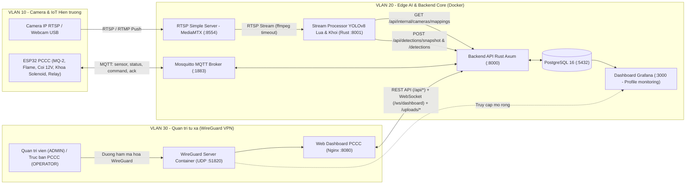
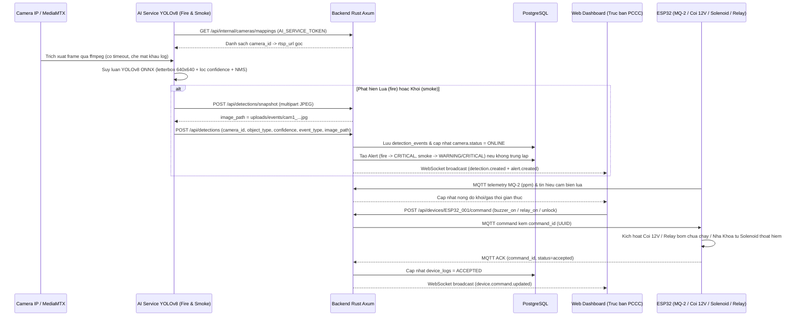

# Thiết kế Kiến trúc Mạng, Hệ thống & Phân lớp PCCC (Tuần 2)

**Đề tài:** *Hạ tầng Giám sát & Báo động An ninh tích hợp Edge AI (YOLOv8) và Mạng VPN WireGuard qua Docker* — **Định hướng Phòng cháy Chữa cháy (PCCC: Lửa `fire` & Khói `smoke`)**.

---

## 1. Sơ đồ Kiến trúc Mạng Phân đoạn VLAN, WireGuard VPN & Docker Services

Hệ thống được thiết kế theo mô hình **Phân đoạn VLAN** kết hợp **WireGuard VPN** và đóng gói hoàn chỉnh bằng **Docker Compose**:

- **VLAN 10 — Mạng Hiện trường (Camera IP RTSP / Webcam USB & ESP32 IoT PCCC)**: Cô lập thiết bị vật lý tại nhà kho, phân xưởng, tầng hầm/bãi xe; chỉ cho phép đẩy luồng RTSP vào MediaMTX và giao tiếp MQTT tới Broker.
- **VLAN 20 — Mạng Xử lý Trung tâm (Edge AI YOLOv8 + Backend Rust + PostgreSQL + Mosquitto)**: Chạy dịch vụ phân tích Lửa/Khói tại biên (Jetson Nano / PC GPU Nvidia GTX 1650+ hoặc CPU), lưu trữ dữ liệu và điều phối báo cháy.
- **VLAN 30 — Mạng Quản trị từ xa (WireGuard VPN Tunnel)**: Cán bộ quản trị (`ADMIN`) và trực ban PCCC (`OPERATOR`) kết nối vào Web Dashboard và Grafana thông qua đường hầm mã hóa **WireGuard VPN** (`UDP :51820`), không mở trực tiếp cổng quản trị ra Internet công cộng.

---

## 2. Cấu trúc Phân lớp Backend Rust (9 Thư mục Tiếng Việt)

Backend viết bằng **Rust (`Axum 0.7` + `SQLx 0.8` + `Tokio` + `Rumqttc`)**, tách biệt trách nhiệm rõ ràng theo **9 thư mục tiếng Việt** trong `backend/src/`:

| Tầng Kiến trúc | Thư mục / Tệp nguồn | Trách nhiệm chính |
|---|---|---|
| **1. Cấu hình** | `backend/src/cau_hinh/mod.rs` | Đọc biến môi trường (`.env`): cổng, chuỗi kết nối PostgreSQL/SQLite, khóa JWT, `AI_SERVICE_TOKEN`, MQTT, bootstrap Admin. |
| **2. Bảo mật & RBAC** | `backend/src/bao_mat/mod.rs` | Băm mật khẩu `bcrypt`, cấp/giải mã JWT HS256, kiểm tra `current_user`, `admin_user`, so sánh constant-time `require_ai_service_token`. |
| **3. Cơ sở dữ liệu** | `backend/src/co_so_du_lieu/{ket_noi,khoi_tao_bang}.rs` `database/{init.sql,seed.sql}` | Quản lý `AnyPool` + `AppState`, ánh xạ dòng dữ liệu SQLx và tự động khởi tạo 8 bảng SQL. |
| **4. Mô hình dữ liệu** | `backend/src/mo_hinh_du_lieu/mod.rs` | Struct ánh xạ 8 bảng (`User`, `Camera`, `Device`, `SensorRecord`, `DetectionEvent`, `Alert`, `DeviceLog`, `SystemLog`) và `RuntimeSettings`. |
| **5. Khuôn mẫu JSON** | `backend/src/khuon_mau_du_lieu/mod.rs` | Kiểm tra hợp lệ đầu vào (validate `rtsp_url`, `username`, `password`, ngưỡng cảm biến MQ-2, chống path traversal `image_path`). |
| **6. Định tuyến API** | `backend/src/dinh_tuyen_api/` (8 file chức năng) | Tách riêng từng trang/nghiệp vụ: `xac_thuc.rs`, `quan_ly_nguoi_dung.rs`, `quan_ly_camera.rs`, `thiet_bi_va_cam_bien.rs`, `su_kien_ai.rs`, `canh_bao_an_ninh.rs`, `thong_ke_va_nhat_ky.rs`, `he_thong_va_cai_dat.rs`. |
| **7. Nghiệp vụ nền** | `backend/src/dich_vu_nghiep_vu/mod.rs` | Che mật khẩu RTSP (`redact_rtsp_url`), tạo Admin mặc định, nạp dữ liệu mẫu PCCC và ghi nhật ký kiểm toán (`system_logs`). |
| **8. Giao tiếp MQTT** | `backend/src/giao_tiep_mqtt/mod.rs` | Lắng nghe telemetry MQ-2 / trạng thái / `ACK` từ ESP32 và phát lệnh điều khiển PCCC xuống MQTT Broker. |
| **9. WebSocket Realtime** | `backend/src/ket_noi_websocket/mod.rs` | Quản lý kênh `/ws/dashboard`, broadcast tức thì `detection.created`, `alert.created`, `alert.resolved`, `device.status`, `device.command.updated`. |
| **Giao diện (View)** | `frontend/{index.html,css/style.css,js/app.js,js/api.js}` | 10 màn hình Web Dashboard PCCC, hiển thị ảnh snapshot cháy/khói, điều khiển ứng cứu ESP32 và trạng thái hạ tầng thực tế. |

---

## 3. Ma trận Phân quyền Truy cập (RBAC)

| Chức năng / Endpoint | `OPERATOR` (Trực ban PCCC) | `ADMIN` (Quản trị viên) | `AI_SERVICE_TOKEN` |
|---|:---:|:---:|:---:|
| Đăng nhập (`POST /api/auth/login`), xem phiên (`GET /api/auth/me`) | Có | Có | — |
| Xem Camera (đã che mật khẩu RTSP), AI Lửa/Khói, IoT, Cảnh báo, Thống kê | Có | Có | — |
| Xác nhận xử lý cảnh báo cháy (`PUT /api/alerts/:id/resolve`) | Có | Có | — |
| Gửi lệnh ứng cứu PCCC (`relay_on/off`, `buzzer_on/off`, `unlock/lock`) | Có | Có | — |
| Quản lý Camera (Thêm / Sửa / Xóa `/api/cameras/*`) | Không (`403`) | **Có** | — |
| Quản lý Người dùng (`GET/POST/PUT/DELETE /api/users/*`) | Không (`403`) | **Có** | — |
| Thêm/Xóa mạch ESP32, Xóa nhật ký, Lưu Cài đặt hệ thống | Không (`403`) | **Có** | — |
| Lấy ánh xạ RTSP gốc (`GET /api/internal/cameras/mappings`) | Không (`401`/`403`) | Không (`401`/`403`) | **Có (Nội bộ)** |
| Tải ảnh snapshot & gửi sự kiện AI (`POST /api/detections/snapshot`, `/detections`) | Có (thử nghiệm) | Có (thử nghiệm) | **Có** |

---

## 4. Luồng Xử lý Phát hiện Lửa & Khói và Ứng cứu Khẩn cấp

---

## 5. Quy tắc An toàn & Bảo mật Hệ thống

1. **Bảo vệ thông tin Camera RTSP**: Mật khẩu trong `rtsp_url` không bao giờ trả ra Frontend (`redact_rtsp_url`), không ghi vào nhật ký hệ thống hay log lỗi `ffmpeg`, và đường dẫn `/api/internal/*` bị Nginx Frontend chặn `403`.
2. **Bảo vệ tệp tải lên Snapshot**: Kiểm tra magic bytes thực tế (`JPEG`/`PNG`/`WebP`), tự sinh tên tệp theo `UUID`, chặn hoàn toàn ký tự điều hướng thư mục (`..`) và phục vụ tĩnh chỉ đọc tại `/uploads`.
3. **An toàn điều khiển thiết bị chữa cháy**: AI không tự động kích hoạt Relay bơm nước hay mở khóa cửa thoát hiểm từ một khung hình đơn lẻ; mọi thao tác kích hoạt phần cứng đi qua `command_id` kèm phản hồi `ACK` từ ESP32 (hoặc cảnh báo quá thời gian `TIMEOUT`).
4. **Trạng thái hạ tầng trung thực**: Trang `Trạng thái hệ thống` kiểm tra thực tế các kết nối (`PostgreSQL`, `Mosquitto`, `ESP32`, `RTSP`, `AI Worker`, `WireGuard VPN`) — thành phần nào tắt sẽ hiển thị chấm xám tĩnh `"Tạm thời chưa hoạt động"`.
