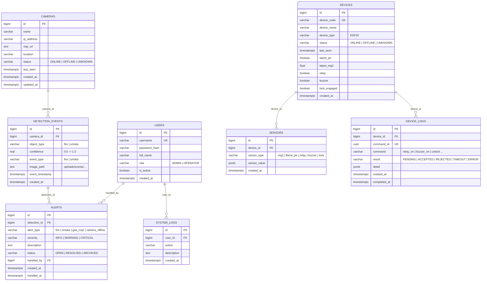

# Thiết kế Cơ sở Dữ liệu PostgreSQL — Hệ thống PCCC (Tuần 2 & Tuần 4)

Cơ sở dữ liệu **PostgreSQL 16** (tương thích SQLite khi chạy thử cục bộ) được quản lý bởi tầng `backend/src/co_so_du_lieu/` (`SQLx`), lưu trữ toàn bộ dữ liệu giám sát cháy/khói, thiết bị IoT ESP32 và nhật ký kiểm toán, đồng thời cung cấp trực tiếp nguồn dữ liệu thời gian thực cho **Dashboard Grafana** (khi bật profile `monitoring`).

---

## 1. Sơ đồ Quan hệ Thực thể (ERD)

---

## 2. Chi tiết 8 Bảng Dữ liệu và Ràng buộc Toàn vẹn (Tuần 4)

1. **`users`**: Tài khoản quản trị và trực ban PCCC. `username` là duy nhất (`UNIQUE`); `password_hash` lưu chuỗi băm `bcrypt`; `role` giới hạn trong `('ADMIN', 'OPERATOR')`.
2. **`cameras`**: Danh sách Camera IP RTSP / luồng MediaMTX lắp đặt tại các khu vực nguy cơ cháy (Nhà kho, Phân xưởng, Tầng hầm bãi xe, Phòng kỹ thuật điện). `rtsp_url` lưu địa chỉ gốc (chỉ cấp cho AI Service qua `/api/internal/cameras/mappings`, luôn che mật khẩu khi trả về Frontend).
3. **`devices`**: Danh sách mạch **ESP32 PCCC**. `device_code` (`UNIQUE`) khớp với topic MQTT `security/device/{device_code}/...`. Các cột trạng thái mới nhất phục vụ hiển thị nhanh trên Dashboard:
   - `latest_mq2`: Nồng độ khói / khí dễ cháy MQ-2 gần nhất (ppm, ràng buộc `>= 0`).
   - `latest_pir`: Trạng thái cảm biến lửa hồng ngoại / tín hiệu số tại chỗ (GPIO 27).
   - `relay`: Trạng thái **Mạch Relay kích hoạt** (bơm chữa cháy / phun sương, GPIO 26).
   - `buzzer`: Trạng thái **Còi báo động 12V** (GPIO 25).
   - `lock_engaged`: Trạng thái **Khóa từ Solenoid cửa thoát hiểm** (GPIO 33 — `TRUE`: đang khóa; `FALSE`: đã mở cửa thoát hiểm khẩn cấp).
4. **`sensors`**: Chuỗi thời gian (time-series) lịch sử nồng độ khói/gas MQ-2 và trạng thái cơ cấu chấp hành, có chỉ mục `(device_id, sensor_type, created_at DESC)` tối ưu cho cả Dashboard và **Grafana**.
5. **`detection_events`**: Toàn bộ sự kiện phát hiện **Lửa (`fire`)** và **Khói (`smoke`)** do YOLOv8 gửi về, ràng buộc `0 <= confidence <= 1`, kèm `image_path` trỏ đến ảnh snapshot thật trong `uploads/events/`.
6. **`alerts`**: Cảnh báo PCCC phát sinh từ AI (`detection_id` liên kết tới `detection_events`), từ cảm biến MQ-2 vượt ngưỡng hoặc camera mất tín hiệu (`detection_id IS NULL`). Ghi nhận người xử lý (`handled_by`) và thời điểm xử lý (`handled_at`).
7. **`device_logs`**: Nhật ký gửi lệnh điều khiển PCCC (`relay_on/off`, `buzzer_on/off`, `unlock/lock`) có `command_id` (UUID) duy nhất để đối chiếu phản hồi `ACK` từ ESP32.
8. **`system_logs`**: Nhật ký kiểm toán hệ thống (đăng nhập, quản lý camera/người dùng, phát hiện cháy/khói, xử lý cảnh báo, điều khiển thiết bị).

---

## 3. Khởi tạo Schema & Dữ liệu Mẫu PCCC (Tuần 4)

- **Schema SQL chuẩn PostgreSQL**: [`database/init.sql`](../database/init.sql) định nghĩa đầy đủ 8 bảng và hệ thống chỉ mục B-tree tối ưu truy vấn thời gian thực.
- **Tự động khởi tạo trong Backend Rust**: Hàm `init_schema()` trong [`backend/src/co_so_du_lieu/khoi_tao_bang.rs`](../backend/src/co_so_du_lieu/khoi_tao_bang.rs) tự động tạo bảng khi server khởi động (hỗ trợ cả PostgreSQL và SQLite).
- **Dữ liệu mẫu PCCC (`database/seed.sql`)**: Cung cấp kịch bản mẫu gồm 4 camera tại khu vực trọng điểm PCCC (*Nhà kho Hóa chất*, *Xưởng Sản xuất A*, *Tầng hầm Bãi xe B1*, *Phòng Kỹ thuật Điện*), 3 mạch ESP32 PCCC, lịch sử cảm biến MQ-2, 5 sự kiện phát hiện **Lửa (`fire`)** & **Khói (`smoke`)**, 4 cảnh báo cháy/khói/khí gas, nhật ký kích hoạt Còi 12V / Khóa từ Solenoid và nhật ký hệ thống.
- **Nạp dữ liệu mẫu tự động**: Đặt `SEED_DEMO_DATA=true` trong `.env` để hàm `seed_demo_data_if_empty()` trong [`backend/src/dich_vu_nghiep_vu/mod.rs`](../backend/src/dich_vu_nghiep_vu/mod.rs) tự động nạp dữ liệu khi CSDL trống (mặc định `false` trong vận hành sạch).
