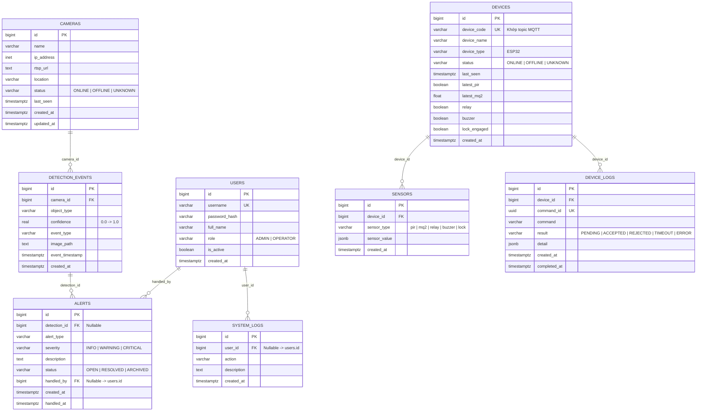

# Thiết kế Cơ sở Dữ liệu — PostgreSQL (Tuần 2 & Tuần 4)

## 1. Sơ đồ Quan hệ Thực thể (ERD)

---

## 2. Chi tiết các Bảng và Ràng buộc Toàn vẹn (Tuần 4)

1. **`users`**: Lưu tài khoản người dùng. `username` là duy nhất (`UNIQUE`); `password_hash` lưu chuỗi băm `bcrypt`; `role` giới hạn trong `('ADMIN', 'OPERATOR')`.
2. **`cameras`**: Lưu thông tin kết nối camera IP. Không cho phép xóa camera nếu đã phát sinh lịch sử trong `detection_events` (`ON DELETE RESTRICT` & kiểm tra ở tầng API trả `409 Conflict`).
3. **`devices`**: Lưu danh sách thiết bị IoT. `device_code` (`UNIQUE`) dùng làm định danh trong topic MQTT `security/device/{device_id}/...`. Các cột `latest_pir`, `latest_mq2`, `relay`, `buzzer`, `lock_engaged` được denormalize để truy vấn nhanh trạng thái hiện tại trên Dashboard.
4. **`sensors`**: Lưu chuỗi thời gian (time-series) của từng loại cảm biến. Đánh chỉ mục kết hợp `(device_id, sensor_type, created_at DESC)`.
5. **`detection_events`**: Lưu toàn bộ sự kiện do AI gửi về, ràng buộc `0 <= confidence <= 1`.
6. **`alerts`**: Lưu cảnh báo an ninh (có thể gắn với `detection_id` hoặc cảnh báo thiết bị/hệ thống độc lập khi `detection_id IS NULL`). Lưu người xử lý (`handled_by`) và thời điểm xử lý (`handled_at`).
7. **`device_logs`**: Lưu nhật ký điều khiển thiết bị IoT với `command_id` duy nhất để đối chiếu bản tin `ACK` từ ESP32.
8. **`system_logs`**: Lưu nhật ký kiểm toán hệ thống (đăng nhập, thêm/sửa/xóa camera, xử lý cảnh báo, nhận sự kiện AI).

---

## 3. Khởi tạo Schema và Dữ liệu Mẫu (Tuần 4)

- **File SQL khởi tạo**: [`database/init.sql`](../database/init.sql) tạo đầy đủ 8 bảng và các B-tree index tối ưu truy vấn theo thời gian.
- **File dữ liệu mẫu SQL**: [`database/seed.sql`](../database/seed.sql) cung cấp dữ liệu mẫu cho 4 camera, 3 thiết bị ESP32, lịch sử cảm biến, 5 sự kiện nhận diện AI, 4 cảnh báo, nhật ký điều khiển và nhật ký hệ thống.
- **Tự động khởi tạo khi chạy Backend**: Khi `SEED_DEMO_DATA=true` (mặc định trong môi trường phát triển), hàm `seed_demo_data_if_empty()` trong [`backend/app/services/__init__.py`](../backend/app/services/__init__.py) tự động nạp bộ dữ liệu mẫu nếu CSDL đang trống, giúp nhóm review ngay giao diện Tổng quan với dữ liệu thật từ API.
